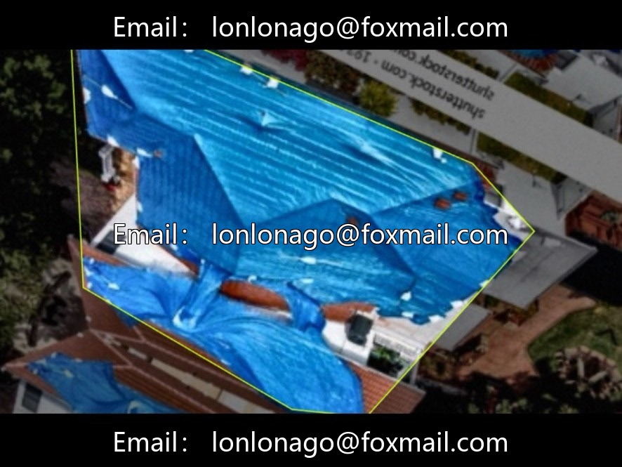
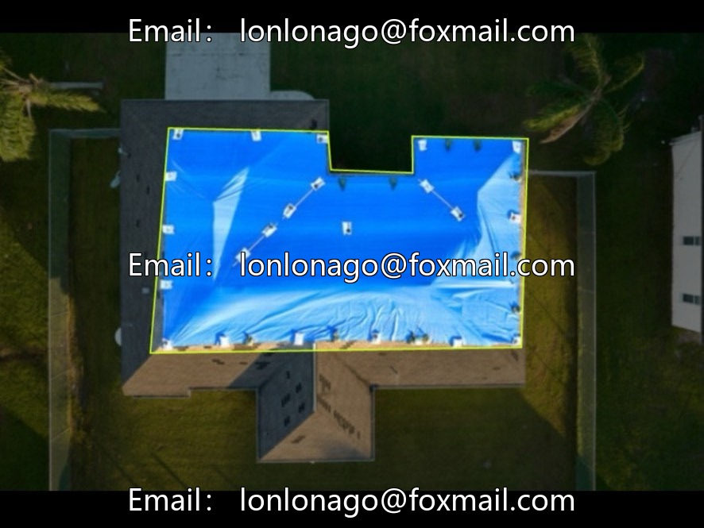
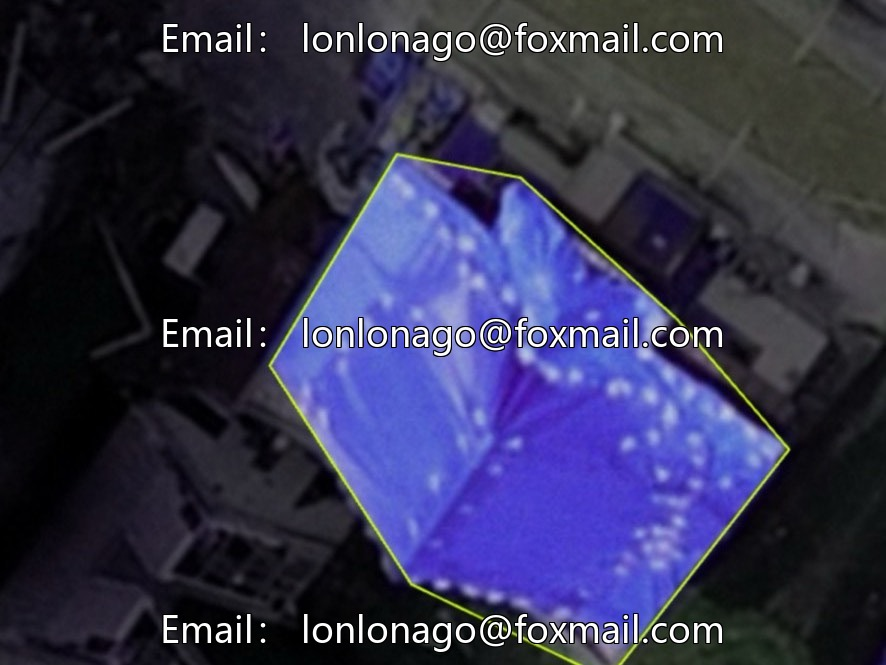
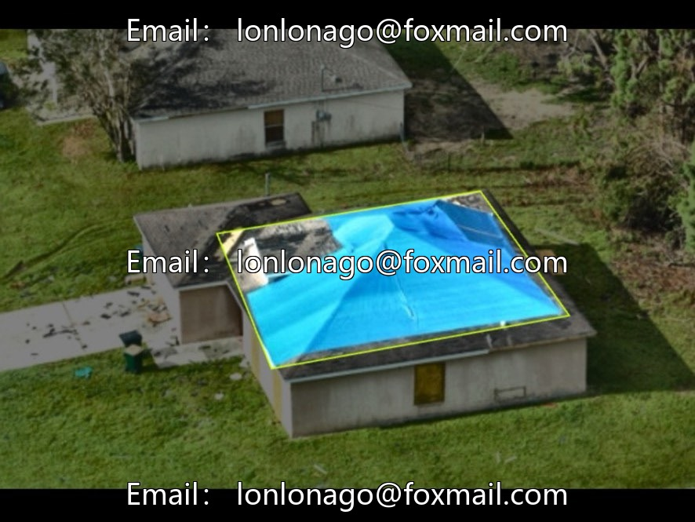
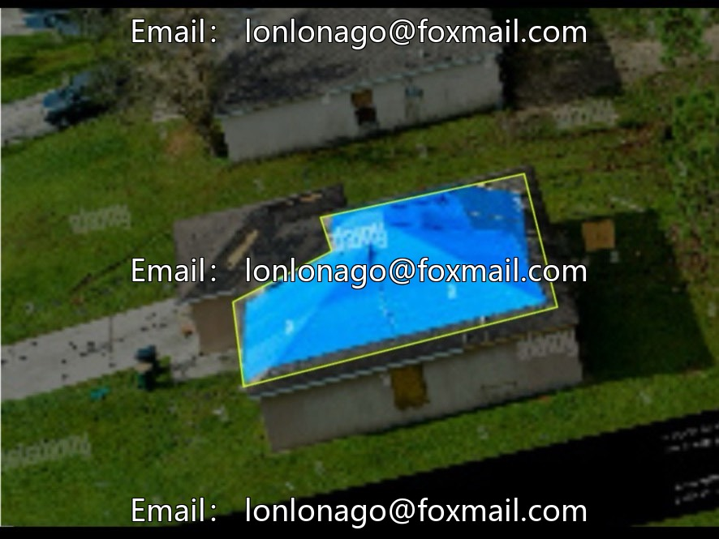

# Blue Target Identification Dataset (Blue Greenhouse/Roof Detection) | Issue 10593

## Body

Blue Target Identification Dataset (Blue Greenhouse/Roof Detection) | Issue 10593

The dataset consists of 680 images, focusing on the "blue" category, suitable for quickly building lightweight detection models for blue objects (such as greenhouses, rooftops, water bodies). The annotation format is YOLO, covering different lighting conditions and the shapes of blue objects, enhancing the generalization ability of the model.

Core Category: Category 1 - Blue
Task Type: Object Detection
Total Images: 680
Annotation Format: YOLO format
Scene Features: Covering different lighting, backgrounds, and the shapes of blue objects to enhance the model's generalization capabilities.

Applicable scenarios
Remote sensing analysis: Identifying targets such as water bodies and blue roofs in aerial/remotely sensed images, aiding land use classification.
Agricultural monitoring: Detecting the distribution and changes of blue greenhouses and blue roofs
Visual Navigation: Provides blue landmark recognition capabilities for robots or drones, aiding in positioning and path planning.
Industrial Inspection: Automated Inspection and Segregation of Blue Parts on the Production Line

The dataset is lightweight and focused, suitable for data as a baseline task for color target detection or for rapid validation of color feature extraction algorithms. The image scenes are diverse but small in scale (680 images), it is recommended to enhance the model's robustness under different lighting conditions by adjusting brightness, contrast, and saturation. A single-category design facilitates quick deployment, but in practical applications, it is necessary to differentiate from similar color targets (such as green and purple) and may require supplementation with shape or texture features.

Virtual materials, once sold, are non-refundable.
Interested friends, click "I want" to proceed.

## Images

## Payment

Here is a pay link on Stripe ( https://buy.stripe.com/3cs8yP7sY87d0vu9AB ). Please contact me lonlonago@foxmail.com after funding $89, and I will send you a complete data files , thank you!

